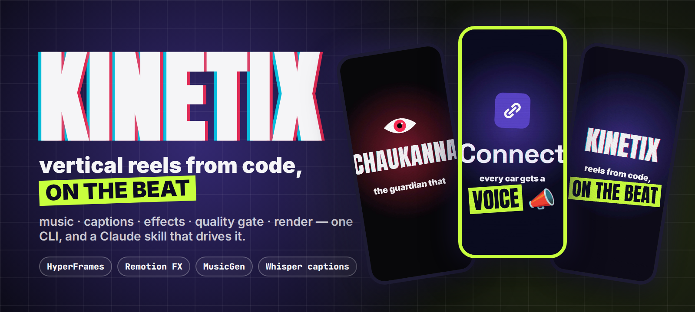
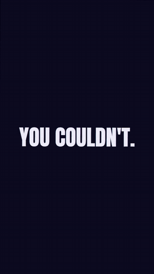
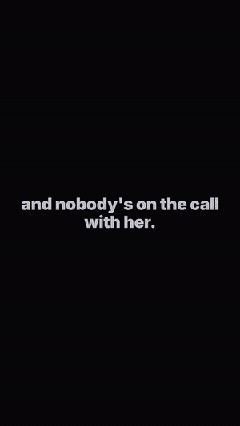
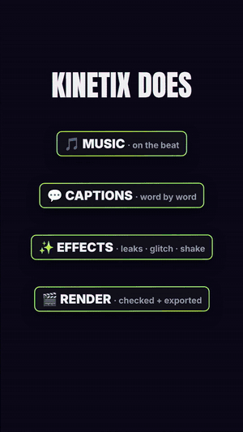
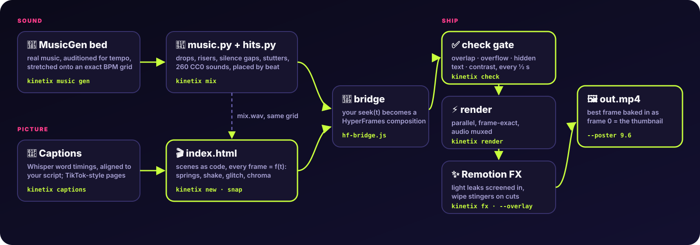
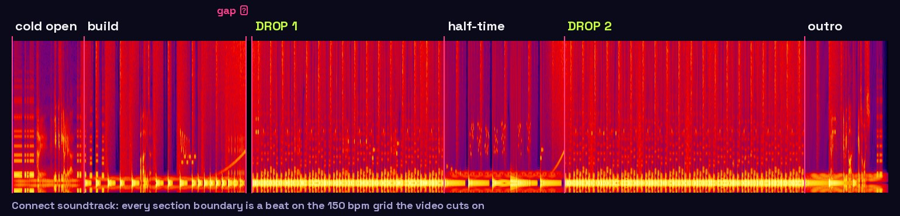
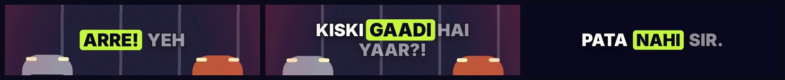
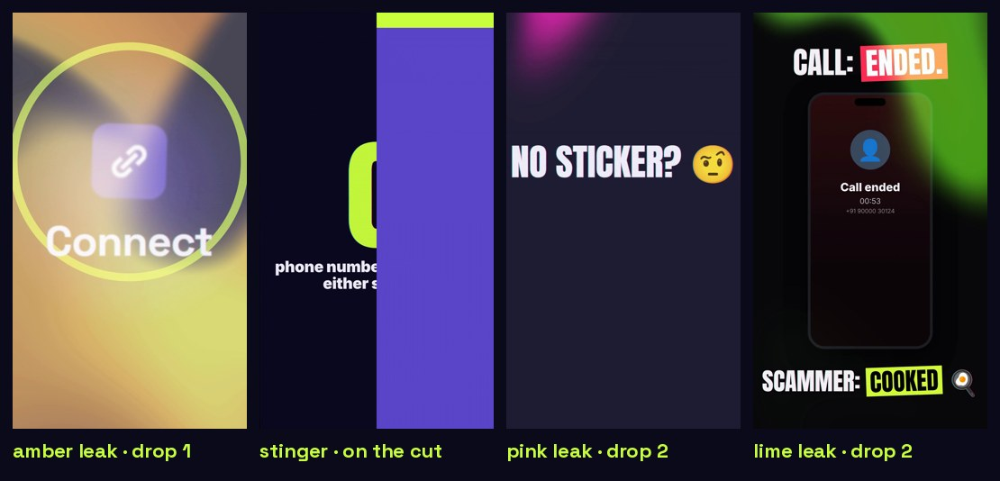

<p align="center"></p>

<p align="center">
  <a href="https://github.com/nikhilcherry/kinetix/actions/workflows/ci.yml"></a>
  
  
  
  
  
</p>

**Kinetix makes hype reels the way you'd write a web page.** Scenes are HTML, motion is a function of time, and the soundtrack is generated on the *same* beat grid, so every cut, shake and drop lands on the beat by construction. One CLI goes from an empty folder to a checked, rendered MP4 with a thumbnail that actually shows on X and YouTube. A bundled **Claude Code skill** lets you just say *"make a reel about my project"*.

<table>
<tr>
<td align="center" width="33%"><br><b>Connect</b><br><sub>58 s · voice + TikTok captions · real phone footage</sub><br><a href="https://youtube.com/shorts/r2QJgsw-6Nk">▶ watch</a> · <a href="examples/connect">source</a></td>
<td align="center" width="33%"><br><b>Chaukanna</b><br><sub>61 s · phonk · live risk gauge · stamp slams</sub><br><a href="https://youtube.com/shorts/3_WPESsHV80">▶ watch</a> · <a href="examples/chaukanna">source</a></td>
<td align="center" width="33%"><br><b>Starter template</b><br><sub>19 s · what <code>kinetix new</code> gives you</sub><br><a href="template">source</a></td>
</tr>
</table>

## How it fits together

<p align="center"></p>

| | piece | what it does |
|---|---|---|
| 🎵 | **[hypebeat](music/)** | MusicGen writes a real track from a prompt. Kinetix auditions seeds, measures the tempo, stretches it onto an exact BPM grid and puts a beat at t = 0. |
| 🥁 | **[hits.py](music/hits.py)** | Drops, risers, silence gaps, filter sweeps, vocal stutters, ducking, plus 260 CC0 recorded sounds, all placed by beat number. |
| 🎬 | **[runtime](runtime/)** | Scenes on a timeline with spring physics, noise-driven camera shake, beat punches, chromatic aberration, glitch slices and flashes. |
| 💬 | **[captions](captions/)** | Whisper word timings aligned to *your* script (so Hinglish stays Hinglish), paged TikTok-style by `@remotion/captions`. |
| 🌉 | **[bridge](bridge/)** | Turns any `seek(t)` page into a [HyperFrames](https://github.com/heygen-com/hyperframes) composition, so you get its quality gate and parallel renderer for free. |
| ✨ | **[fx](fx/)** | [Remotion](https://www.remotion.dev) renders light leaks and wipe stingers as transparent clips. Leaks are screened in as light, so text stays readable. |
| 🖼 | **poster** | Bakes the best frame in as frame 0, the thumbnail every platform shows. |

## Quickstart

Needs Node 22+, ffmpeg and Python 3.10+.

```bash
git clone https://github.com/nikhilcherry/kinetix && cd kinetix
./setup.sh                      # add --musicgen --captions for AI music + captions, --skill for Claude Code
export PATH="$PWD:$PATH"

kinetix new my-reel             # vertical starter (add --landscape for 16:9)
kinetix mix my-reel             # pure-synth soundtrack, no GPU needed
kinetix snap my-reel 1.5,5,10   # contact sheet: look at it
kinetix check my-reel           # 0 errors or it isn't done
kinetix render my-reel -o my-reel.mp4 --poster 12
```

Then open `my-reel/index.html`, change the words, and re-render.

### With Claude Code

```bash
./setup.sh --skill               # links skill/kinetix into ~/.claude/skills
```

> *"Make a 45-second vertical reel about my app in ~/code/my-app. Gen Z energy, no voice."*

The skill walks Claude through the whole job:
- read your README and site for **real** claims, and capture real screens
- plan the reel on the beat grid
- write the scenes and the soundtrack
- verify by *looking* (contact sheets) and *measuring* (loudness per section, spectrograms, Whisper on the voice)
- clear the quality gate and render

See [`skill/kinetix/SKILL.md`](skill/kinetix/SKILL.md).

## Writing a reel

```js
const K = Kinetix.init({ width: 1080, height: 1920, bpm: 150, build: [[3.2, 9.2]], drops: [[9.6, 16]], glitches: [9.6] });

K.scene(9.6, 12.8, `
  <div class="c big name" style="left:540px;top:800px;font-size:230px">KINETIX</div>
  <div class="c big tag" style="left:540px;top:1000px;font-size:160px"><span class="hl acc">ON THE BEAT</span></div>`,
  (lt, q) => { K.slam(q(".name"), lt, 0, { from: 3 }); K.slam(q(".tag"), lt, 1.6, { r: -2 }); });

K.start({ dur: 19.2 }).then(({ timeline }) => { window.__timelines["main"] = timeline; });
```

At 150 bpm a beat is 0.4 s, so `K.slam(..., 1.6)` lands exactly one bar into the scene, and `m.add(9.6 + 1.6, h.impact())` in `music.py` hits on the same frame. Patterns for phone frames, footage on a tilted hologram panel, stat slams, chat bubbles, counters and data streams are in [recipes](skill/kinetix/references/recipes.md). The full API is in [runtime.md](skill/kinetix/references/runtime.md).

## The soundtrack is code too

<p align="center"></p>

```bash
kinetix music gen "dark cyberpunk drift phonk, distorted 808, cowbell" --bpm 150 --seconds 60 -o my-reel/assets/bed.wav
```

```python
m = Mix("assets/bed.wav", seconds=51.2)
m.lowpass([(0, 380), (4.8, 380), (13.6, 16000)])   # muffled intro, filter opens through the build
m.add(13.2, h.riser(0.8)); m.gap(14.0, 14.4)        # riser into a beat of silence…
m.add(14.4, h.impact())                             # …then the drop
m.add(21.0, h.sfx("keyboard/keypress-012"))         # recorded CC0 sounds by name
m.write("assets/mix.wav")
```

MusicGen follows the BPM in the prompt closely: test takes measured 150.0 ± 0.1. librosa's beat tracker misreads phonk and club tempos (it called 150 "121" and "199"), so Kinetix measures with onset autocorrelation and never stretches more than ±12%. No GPU? `Mix(bpm=150, seconds=20)` builds a full pure-synth track: jersey-club kicks, 808s, claps, hats, car-horn riffs, risers and impacts. Details in [music.md](skill/kinetix/references/music.md).

## Captions that keep your words

<p align="center"></p>

```bash
kinetix captions my-reel    # captions-lines.json: [{"clip": "assets/line1.wav", "at": 1.62, "text": "Arre! Yeh kiski gaadi hai yaar?!", "y": 600}]
```

Whisper in Hindi mode returns misspelt Devanagari for Hinglish. Kinetix runs it in English mode with your script as the prompt, so it returns *your exact words* with their timings. Pages come from `@remotion/captions`, built per line so words never bleed between lines.

## Effects

<p align="center"></p>

```bash
kinetix fx leak --hue 200 -o overlays/leak-cyan.mov          # 0 amber · 70 pink · 200 cyan · 290 lime
kinetix fx stinger --colors "#c8ff3d,#5a45c9" -o overlays/stinger.mov
kinetix render my-reel -o out.mp4 --overlay overlays/leak-cyan.mov@9.2:0.8 --overlay overlays/stinger.mov@15.7
```

Overlays are rendered once by Remotion as ProRes 4444 with alpha, then composited by ffmpeg. Leaks use a *screen* blend: an opaque overlay buried the logo in early tests, while light added on top keeps every word legible. Add your own effects as compositions in [`fx/src/Root.tsx`](fx/src/Root.tsx).

## The quality gate

`kinetix check` runs HyperFrames' audit every half second of the reel. It reports text overflowing its box, overlapping text, text hidden under other elements, contrast failures, and runtime errors.

- **Chaukanna:** on its first run the gate reported **12 errors**. Most were glyphs of the display font poking out of highlight boxes, now fixed in `kinetix.css` with `line-height: 1.12`. One was low-contrast white text over animated sound rings, now fixed with an outline. The rest were deliberate overlaps (a stamp over a warrant) that needed marking with `data-layout-allow-overlap`.
- **Connect:** the gate flagged its HONK bursts as hidden under the cars. The frames showed they weren't, so that was a false positive, marked with `data-layout-allow-occlusion`.

**Treat the gate as a reviewer, not an oracle:** fix what's real, mark what's intentional, and compare frames before claiming a fix.

## CLI

| command | |
|---|---|
| `kinetix doctor` | check node, ffmpeg, Python deps, GPU, built pieces |
| `kinetix new <dir> [--landscape]` | start from the template |
| `kinetix sync <dir>` | refresh the runtime, bridge and vendor bundles in a reel |
| `kinetix music gen "<prompt>" --bpm --seconds -o` | MusicGen bed locked to the grid |
| `kinetix mix <dir> [args]` | run the reel's `music.py` (with `hits` importable) → `assets/mix.wav` |
| `kinetix captions <dir>` | word-timed captions → `assets/captions.js` |
| `kinetix fx leak\|stinger ... -o x.mov [--landscape]` | render an overlay with Remotion |
| `kinetix snap <dir> t1,t2,...` | PNG frames and a contact sheet |
| `kinetix check <dir> [--samples N]` | the quality gate |
| `kinetix render <dir> -o out.mp4 [--overlay f@t[:op[:mode]]]... [--poster t]` | render → overlays → thumbnail |
| `kinetix port reel.html <dir>/index.html --dur 30` | convert a standalone `seek(t)` page to a HyperFrames composition |

## Repo layout

```
kinetix               the CLI
runtime/              kinetix.js (scene engine) + kinetix.css (theme, captions, FX layers)
bridge/hf-bridge.js   seek(t) page → HyperFrames timeline
music/                hypebeat.py (MusicGen bed), hits.py (Mix + synth kit), sfx/ (CC0)
captions/             captions.py (Whisper, script-aligned)
fx/                   Remotion project: Leak, Stinger (+H landscape versions)
tools/                overlay.sh, poster.sh, port.py, build-vendor.sh, tts_sarvam.py
template/             what `kinetix new` copies
examples/             connect/, chaukanna/
skill/kinetix/        the Claude Code skill + references
```

## Gotchas we hit, so you don't

- **A GSAP timeline is a thenable.** Returning one from an async function waits for it to *finish*, and a paused timeline never does, so every frame rendered blank with no error. The bridge returns `{ timeline }`.
- **Footage must be `<video data-start>`, not JPG sequences, and screen swaps must use `stackSet`.** Otherwise the renderer can capture a frame before the image decodes.
- **Pick numbers once.** Your own site may say 1.5 s in one place and 1.2 s in another; a reel that quotes both looks careless.
- **Remotion renders with `--gl=swangle`**, which works without a GPU-friendly GL stack.
- **musicgen-medium only ships as an 8 GB fp32 `.bin`.** `small` is the default because it runs anywhere.

## Licence

MIT for Kinetix itself. HyperFrames is Apache-2.0. Remotion has its own [licence](https://www.remotion.dev/license): free for individuals and companies of up to 3 people. **MusicGen output is CC-BY-NC.** The bundled sounds are CC0. Details in [NOTICE.md](NOTICE.md).
