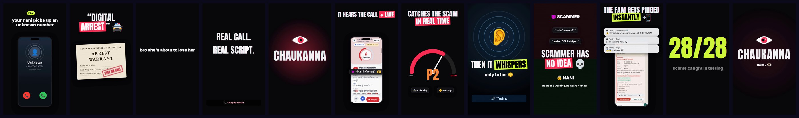

# Example: Chaukanna (61 s, 1080×1920, phonk + voice)



The reel for Chaukanna, an AI that listens to a scam call and whispers to the person being targeted, built at a 24 h hackathon.

**What it shows off:**
- **A dark, tense cold open:** a Nokia-style ringtone, a fake CBI call, and a warrant with a stamp slam.
- **A pure-numpy 150 bpm phonk:** cowbell melody, 808s, a record scratch on the freeze-frame, a vine boom on "scammer has NO IDEA".
- **Product visuals:** app screenshots in phone frames, a live risk gauge (SVG) sweeping to P0, notifications stacking on beats.
- **Ported, not rewritten:** this page started as a standalone reel and was converted with `kinetix port`. The first `kinetix check` found 12 issues (glyphs poking out of highlight boxes, low-contrast text over animated rings, and deliberate overlaps that needed marking). All were fixed or marked.

**Build it:**

```bash
kinetix mix examples/chaukanna
kinetix render examples/chaukanna -o chaukanna.mp4 --overlay overlays/leak-pink.mov@17.2:0.7 --overlay overlays/leak-lime.mov@36.4:0.6 --poster 19
```

The names and phone numbers in the screenshots are demo personas (Kamala, Ravi, Priya, +91 90000 30124).
