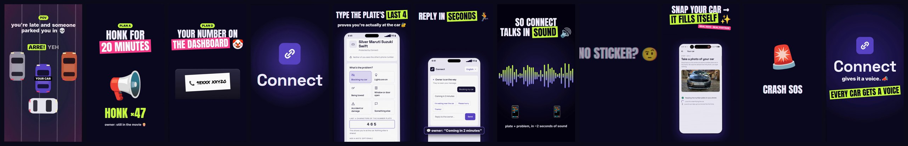

# Example: Connect (58 s, 1080×1920, voice + captions)



The hype reel for [Connect](https://github.com/nikhilcherry/connect): message any car's owner through a QR tag or the plate, with no phone numbers shared.

**What it shows off:**
- **Real app material:** the stranger-side web page captured with the API mocked, and screen recordings from a real phone (`assets/f_plate.mp4`, `assets/f_road.mp4`) played as `<video>` clips.
- **Voices and captions:** Sarvam TTS Hinglish lines (`kiski`, `guard`, `tag`) with word-timed TikTok captions (`captions-lines.json` → `assets/captions.js`).
- **Pure-numpy soundtrack:** `music.py` is a jersey-club beat with car horns as the lead melody, chopped "yaar?!" stutters, data chirps for the sound-link section, and a silence gap before each drop.
- **Optional MusicGen bed:** `kinetix mix examples/connect --bed assets/bed.wav` swaps the synth drums for a bed and arranges it with a moving low-pass (muffled cold open, opening build, underwater half-time). `assets/bed.json` records the prompt and seed.

**Build it:**

```bash
kinetix mix examples/connect
kinetix check examples/connect
kinetix render examples/connect -o connect.mp4 \
  --overlay overlays/leak-warm.mov@15.6:0.8 --overlay overlays/stinger-lime.mov@28.5 \
  --overlay overlays/leak-pink.mov@36.4:0.75 --overlay overlays/leak-lime.mov@53.6:0.6 --poster 18.3
```

The overlays come from `kinetix fx` (see the main README).
