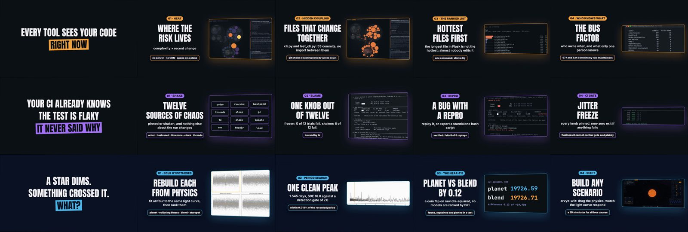

# Example: README demos for three projects (40 s, 1920×1080)



One template, three videos. `gen.py` turns a small config per project (hook lines, brand, four feature scenes with a real screenshot each, four stats, outro) into a landscape reel on the 120 bpm grid, so a project's own README copy and real screenshots become a demo without hand-writing a timeline.

| Project | Video |
|---|---|
| [strata](https://github.com/nikhilcherry/strata) | [youtu.be/J-SnsnLcnZg](https://youtu.be/J-SnsnLcnZg) |
| [jitter](https://github.com/nikhilcherry/jitter) | [youtu.be/BsvzVi-R1Xg](https://youtu.be/BsvzVi-R1Xg) |
| [arvyo](https://github.com/nikhilcherry/arvyo) | [youtu.be/nxsViUQj-1k](https://youtu.be/nxsViUQj-1k) |

**Layout** (beat 0.5 s, bar 2 s): two hook scenes (0 to 8 s), brand slam (8 to 12), four feature scenes with copy on the left and a tilted, slowly zooming screenshot on the right (12 to 28), four stat slams (28 to 36), outro with the repo URL (36 to 40).

**Build one:**

```bash
export PROJECTS=~/Projects            # where the three repos are checked out (their screenshots are the footage)
python3 gen.py strata                 # writes strata-demo/ via `kinetix new --landscape`
cd strata-demo
kinetix music gen "minimal electronic pulse, warm analog synth pads, soft kick, 120 bpm" --bpm 120 --seconds 42 -o assets/bed.wav
kinetix mix .                         # hits on the same grid as the scenes
kinetix check .                       # must end with 0 errors
kinetix render . -o out.mp4 --poster 10.4
```

**What it demonstrates**
- **Config over timeline.** The same scene code serves all three projects; only `CONFIGS` in `gen.py` differs.
- **Image stacks.** The arvyo simulator scene swaps four screenshots with `KinetixBridge.stackSet` (the clones are absolutely positioned so they stack instead of pushing each other down).
- **Zoom inside the frame.** Each panel zooms its image toward the part that matters, clipped by the panel border, so small terminal text becomes readable.
- **Honest copy.** Every claim comes from the project's own README, and every image is a real run.

The MusicGen bed is CC-BY-NC: fine for demos and a personal channel, not for paid work.
